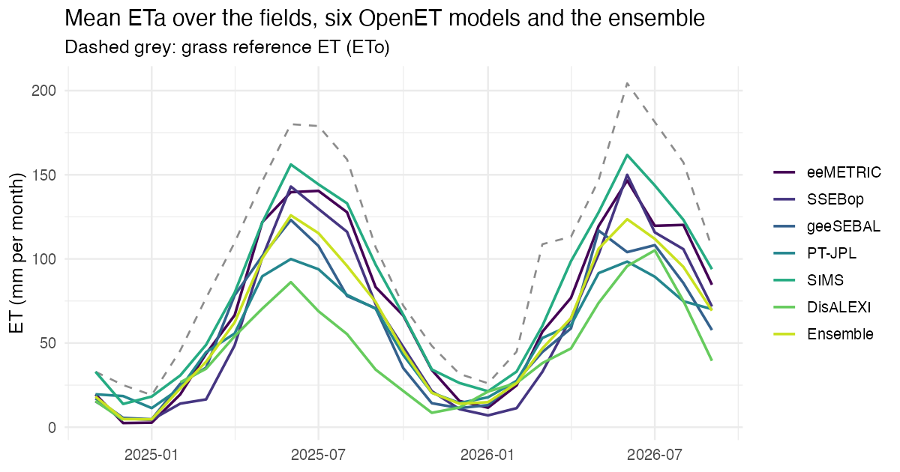
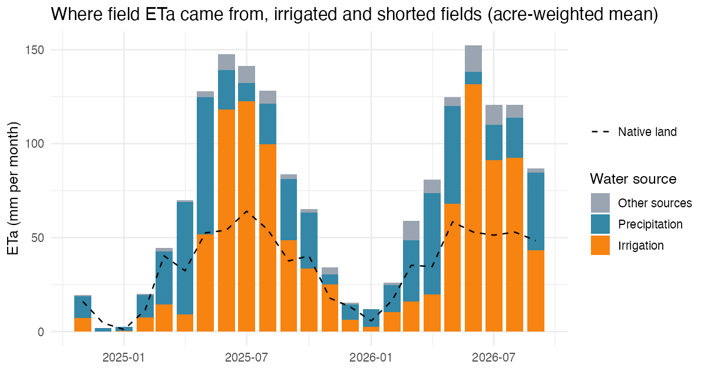
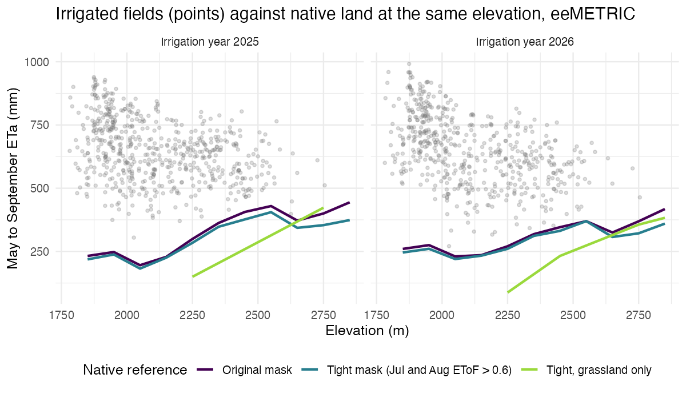

# Irrigation consumptive use

*Roaring Fork River basin (HUC8 14010004), irrigation years 2025 and 2026. Trial model, first published October 2026.*

This chapter explains how the Irrigation tab estimates the water that irrigated fields use up. The companion chapter, [Diversions, rights, and landowners](09-irrigation-rights.md), covers the ditches, water rights, and owners behind those fields.

## Summary

- Irrigated crops and turf in the Roaring Fork used up about **31,800 acre-feet (AF)** of irrigation water in irrigation year 2025 (November 2024 to October 2025), or 1.68 AF per irrigated acre. Irrigation year 2026, through September 30, comes to about 30,500 AF.
- Over May to September the figures are 27,300 AF (2025) and 25,700 AF (2026).
- The satellite model used to measure evapotranspiration is the largest source of uncertainty. Two other OpenET models give 64% to 83% of the headline from May to September.
- The fields use about 27,300 AF (2025) more than nearby native shrubland at the same elevation would. That is the water the basin would see if the fields went dry, at least in the first years.
- Ditches serving the fields diverted about 240,000 AF for irrigation in 2025. On ditches with complete records, the fields used up about 10% of what was diverted to them. Most of the rest returns to the streams.

## What consumptive use means

Plants pull water from the soil and release it to the air as vapor. Water also evaporates from wet soil and leaves. Together this is **evapotranspiration (ET)**. Water that leaves as ET is gone from the basin for good, so it is called **consumptive use**.

Diversion is a different quantity. A ditch takes water from a stream at its headgate. Some of it is used up by crops. The rest seeps from the ditch and from flooded fields into the ground, or runs off the end of the field, and returns to the river over days to months. Downstream ditches divert it again. Satellites measure consumption, not diversion (Oregon Water Resources Department [OWRD], 2025; WestCAT, n.d.).

The terms used below:

| Term | Meaning |
|---|---|
| ETa | Actual ET from all water sources: rain, snowmelt, stored soil water, shallow groundwater, and irrigation |
| ETo | Grass reference ET, what a well-watered grass surface would use under the day's weather (ASCE-EWRI, 2005) |
| EToF | ETa divided by ETo, a measure of how wet a field is |
| Effective precipitation | The part of rain and snowmelt that stays in the root zone and is available to plants |
| Irrigation consumptive use (CU) | The part of ETa supplied by irrigation water: ETa minus effective precipitation and other natural sources |
| Net CU | CU plus incidental losses (ditch evaporation and plants along ditches) |
| NIWR | Net irrigation water requirement: what a crop would use with a full water supply, minus effective precipitation |
| Irrigation year | November to October, labeled by the year it ends in, as in Colorado Division of Water Resources (DWR) diversion records |

## Fields

Fields come from the Colorado Decision Support System (CDSS) Division 5 irrigated lands layer for 2023, the newest year available. A field is in the basin when a point on its surface falls inside the HUC8. There are 668 fields covering 19,722 acres, all in Water District 38, with a median size of 17 acres.

- 616 fields (18,622 acres) are agricultural: grass hay, pasture, and alfalfa, flood and sprinkler irrigated.
- 52 fields (1,100 acres) are golf courses, a park, a lawn, and ranchettes. They are kept as a separate turf class.

Crop labels often come from the USDA Cropland Data Layer, which confuses alfalfa with grass hay in mountain valleys, so the alfalfa share (64% of acres) is probably too high. The label only sets rooting depth here.

### Which fields were irrigated

The 2023 map will not match every field in 2025 and 2026. Each field and year is classed from its EToF against nearby native land in the same 100 m elevation band (see Method B):

- **Irrigated**: field EToF is more than 0.2 above the native reference in July or August.
- **Shorted**: not wet in July or August, but wet in May or June. These fields dried up mid-season and count CU only in their wet months.
- **Fallow**: neither.

Reclamation's Colorado rule (EToF above 0.4 in three months from May to October) does not separate irrigated from native land here, because native shrubland near the fields clears 0.4 in May, June, and October.

| Irrigation year | Irrigated fields | Irrigated acres | Shorted fields | Shorted acres | Fallow fields | Fallow acres |
|---|---|---|---|---|---|---|
| 2025 | 591 | 17,143 | 46 | 1,731 | 31 | 849 |
| 2026 | 546 | 15,214 | 72 | 3,165 | 50 | 1,343 |

## Satellite ET

Monthly ETa comes from OpenET version 2.1 on Google Earth Engine at 30 m (Melton et al., 2022). OpenET runs six models on Landsat imagery and publishes their ensemble. Every month used here is labeled provisional. Each field is shrunk 30 m inward to drop edge pixels that mix in roads, ditch banks, and neighbors; 112 fields too small to keep 10 pixels use their full outline.

The models disagree a lot over these mountain meadows:

| Model | May to Sep ETa, 2025 (mm) | May to Sep ETa, 2026 (mm) |
|---|---|---|
| ETo (reference) | 771 | 797 |
| SIMS | 652 | 650 |
| **eeMETRIC** | **613** | **591** |
| SSEBop | 563 | 546 |
| Ensemble | 512 | 506 |
| geeSEBAL | 481 | 472 |
| PT-JPL | 433 | 424 |
| DisALEXI | 315 | 389 |

**eeMETRIC is the primary model.** It is what Reclamation uses for Upper Colorado consumptive use accounting (Bureau of Reclamation, 2025), and near Kremmling it gave 601 mm on irrigated hay meadows over 2016 to 2019, the best match of the six models to an eddy covariance tower (Cabot et al., 2022). SSEBop and geeSEBAL show the spread. The ensemble is not used: DisALEXI and PT-JPL put irrigated hay at an implausible EToF of 0.4 to 0.55 in these narrow valleys, and SIMS assumes unstressed crop ET even on native land.

Weather comes from gridMET (Abatzoglou, 2013) at the 4 km cell holding each field. Reference ET is OpenET's bias-corrected gridMET ETo, 10% below raw gridMET here. Precipitation over the fields was 333 mm (2025) and 272 mm (2026), against about 1,150 mm of ETo. gridMET precipitation was checked against the eight Roaring Fork SNOTEL sites: below 3,300 m it totals 98% of the gauges.

## Two ways to remove precipitation

ETa includes water the fields would have used without irrigation. Two questions give two answers, and both are reported.

1. **Accounting consumptive use (Method A)**: how much irrigation water did the crop use, after removing the rain and snowmelt that soaked into that field? This is the definition used by Reclamation's Consumptive Uses and Losses reports and is consistent with the consumptive use concept in Colorado water administration. It is the headline.
2. **Depletion above the native baseline (Method B)**: how much more water does the field use than the same land would use unirrigated? This is the right number for basin depletion against natural conditions and for dry-up scenarios.

### Method A: accounting consumptive use

Each field runs a daily soil water balance (Allen et al., 1998) from October 2023 to September 2026. The first year only fills the soil. The balance keeps root-zone water in two pools, one from precipitation and one from irrigation.

1. **Snow.** Precipitation falls as snow below 1 °C mean air temperature and melts at 3 mm per °C per day.
2. **Runoff.** Rain and melt lose surface runoff by the SCS curve number method (CN 75).
3. **Infiltration and drainage.** The rest enters the root zone. Water above field capacity drains below the roots.
4. **Soil.** Water holding capacity is the area-weighted SSURGO available water capacity over 0 to 100 cm; roots reach 0.6 m for grass and 1.2 m for alfalfa.
5. **ET.** Each month's OpenET ETa is spread over its days in proportion to daily ETo. ETa is drawn first from the snowpack (sublimation), then from the root zone.
6. **Irrigation window.** Irrigation can happen only between the first and last month the field's ditches recorded irrigation diversion that year (CDSS records, or the ditch's 2015 to 2024 pattern when that year has no record), capped to April to October. Fields on ditches with no records use a modeled growing season.
7. **Irrigation.** Inside the window, ETa the root zone cannot supply is supplied by irrigation, and the root zone is refilled to field capacity when it dries past half its available water. Outside the window, unsupplied ETa is booked as "other sources" (shallow groundwater, sublimation the snow model misses, or ETa error) and is not counted as irrigation.

**Consumptive use is ET drawn from the irrigation pool.** Snowmelt stored in the soil when the season opens is credited automatically. When both pools hold water, the headline follows Reclamation's convention: drainage removes precipitation water first and ET takes precipitation water first (Bureau of Reclamation, 2025). Two other sharing rules are reported as checks, and they change May to September CU by less than 6%.

Reclamation's own monthly form (ETa minus monthly effective precipitation, with surplus carried forward) is also computed. Here it runs 9% to 17% higher, because OpenET's March and April ETa uses up the carried-over winter water before May, even though the daily balance shows the root zone nearly full on May 1.

### Method B: depletion above the native baseline

Method B subtracts the ETa of nearby native land from the field's ETa, month by month. Reference pixels are NLCD 2021 grassland or shrubland on slopes under 10°, within 5 km of irrigated land, and outside:

- any field mapped as irrigated in 2015, 2020, or 2023, plus 200 m;
- mapped streams (NHDPlus order 3 and up), plus 150 m, and NLCD wetlands, plus 100 m;
- canals and ditches, plus 100 m, and any small stream, plus 60 m (NHD high resolution);
- any pixel with eeMETRIC EToF above 0.6 in both July and August, which removes unmapped irrigation and seeps.

That leaves about 83 km², almost all sagebrush shrubland. Each field's baseline is the mean ETa of reference pixels in its 100 m elevation band (bands with fewer than 500 pixels borrow the nearest band that has enough). Season totals are floored at zero per field.

Two checks support the baseline. Fields the classification calls fallow (mapped hay land that stayed dry all summer) used 297 mm (2025) and 268 mm (2026) from May to September, within 10% of the reference at their elevations. And Method B comes to 57% to 59% of field ETa, close to the 53% to 58% drop in ETa that full irrigation withdrawal produced near Kremmling (Cabot et al., 2022).

Method B is not a competing estimate of Method A. Native land keeps more of its precipitation than wet irrigated soil, which drains more, and sagebrush roots reach deeper soil water and groundwater that never counts as effective precipitation on a field.

### Incidental use

Net CU adds Reclamation's incidental use rate for this HUC8, 18.9% of CU, for ditch evaporation and plants along ditches. It comes from the 1976 to 1980 Colorado main stem rates and is applied to Method A only. Reclamation notes the survey behind these rates was never found, so treat it as a convention (Bureau of Reclamation, 2025).

## Results

**Irrigation year (November to October; 2026 ends September 30).** eeMETRIC.

| Method | 2025 (AF) | 2025 (AF/acre) | 2026 (AF) | 2026 (AF/acre) |
|---|---|---|---|---|
| **A: accounting CU (headline)** | **31,800** | **1.68** | **30,500** | **1.66** |
| A with incidental use (Net CU) | 37,800 | | 36,300 | |
| A, monthly Reclamation form | 37,000 | 1.96 | 34,100 | 1.86 |
| B: depletion above native baseline | 27,300 | 1.44 | 26,100 | 1.42 |

**May to September**, by satellite model.

| Method | eeMETRIC 2025 | SSEBop 2025 | geeSEBAL 2025 | eeMETRIC 2026 | SSEBop 2026 | geeSEBAL 2026 |
|---|---|---|---|---|---|---|
| A: accounting CU | 27,300 | 22,500 | 18,800 | 25,700 | 21,500 | 16,500 |
| B: depletion above native | 22,500 | 15,800 | 9,400 | 20,200 | 15,700 | 9,700 |
| NIWR (full-supply crop need) | 32,600 | | | 31,900 | | |

Per-acre values divide by irrigated plus shorted acres. Turf used about 1,700 AF from May to September in 2025 (1.55 AF per acre), more per acre than hay land (1.44). Near Kremmling, the comparable May to September quantity on irrigated hay averaged 516 mm (1.69 AF per acre) over 2016 to 2022 (Cabot et al., 2022), against 441 mm here in 2025.

## Sensitivity

Each run changes one setting and reruns Method A (eeMETRIC, May to September).

| Change | 2025 | 2026 |
|---|---|---|
| Half the soil water holding capacity | +10.4% | +3.9% |
| 1.5 times the water holding capacity | -7.6% | -3.8% |
| Precipitation 20% higher | -6.9% | -6.6% |
| March and April ETa 30% lower | -5.2% | -4.3% |
| Full field outline (no 30 m edge buffer) | -4.3% | -3.3% |
| Modeled season instead of ditch records | +2.4% | +2.0% |
| Curve number 85 | +0.7% | +0.1% |
| Melt factor 6 mm/°C/day | 0.0% | 0.0% |

Settings that change how much snowmelt is stored at the start of the season matter most. None moves the estimate as much as the choice of satellite model.

## Open issues

- **Water balance closure.** Native reference land evaporates 1.1 to 1.7 times gridMET precipitation in most elevation bands. Either native land receives water from beyond its own precipitation (runon, shallow groundwater, deeper soil water from wetter years), or eeMETRIC runs high on shrubland and in spring and fall, as OWRD (2025) found on dry rangeland. If eeMETRIC is high on native land, Method B is too low. If spring ETa is high on fields too, Method A is somewhat high; the sensitivity runs bound that at under 10%.
- **Groundwater-supported use.** Inside the ditch window the balance books every bit of ETa above the root zone's precipitation water as irrigation. In 2025, about 6,800 AF of May to September CU came from fields whose ETa exceeded ETo (a wetland or subirrigation signature), and 350 AF from months when every linked ditch reported zero diversion. These are flags, not a split by source.
- **Model validation.** None of the OpenET models has been validated on Roaring Fork fields or native land.

## Limitations

- Monthly ETa is spread over days by ETo, so the balance sees no within-month drydown. Monthly and seasonal totals are what it supports.
- Native reference land is shrub on benches and valley sides, not hay meadow. OpenET is less accurate on natural vegetation (Volk et al., 2024).
- Field status uses field-mean EToF; Reclamation classifies pixels. A half-dried field can still read as irrigated.
- Fields are from 2023. Land developed since, and irrigated land not in the map, are missed. The 2023 layer maps about 5,800 fewer acres than 2020 in the basin.
- Every OpenET month is provisional, October 2026 is not yet published, and most 2025 and 2026 diversion records are provisional.
- This is a trial for one basin. It is not a historical consumptive use determination, which is a site-specific engineering analysis with its own treatment of supply, subirrigation, and return flows.

## Reproducing the results

The analysis lives in `docs/Irrigation/` in the project repository: `roaring_fork_diversions.qmd` (run first; it builds the ditch windows), then `roaring_fork_cu.qmd`. Satellite and weather data are pulled once from Earth Engine and cached. Each notebook's last chunk writes the dashboard tables, and `scripts/publish_irrigation.R` copies them, with this chapter's figures, to the app.

## References

Abatzoglou, J. T. (2013). Development of gridded surface meteorological data for ecological applications and modelling. *International Journal of Climatology, 33*(1), 121-131. https://doi.org/10.1002/joc.3413

Allen, R. G., Pereira, L. S., Raes, D., & Smith, M. (1998). *Crop evapotranspiration: Guidelines for computing crop water requirements* (FAO Irrigation and Drainage Paper 56). Food and Agriculture Organization of the United Nations. https://www.fao.org/3/x0490e/x0490e00.htm

ASCE-EWRI. (2005). *The ASCE standardized reference evapotranspiration equation*. American Society of Civil Engineers, Environmental and Water Resources Institute.

Bureau of Reclamation. (2025). *Upper Colorado River System consumptive uses and losses methods manual 1991-2025*. U.S. Department of the Interior, Interior Region 7: Upper Colorado Basin. https://www.usbr.gov/uc/DocLibrary/Reports/ConsumptiveUsesLosses/uc-ucrs-cul-methodsmanual1991-2025-508-20250800.pdf

Cabot, P. E., Derwingson, A. R., Bromley, M., Volk, J. M., Torres-Rua, A., & Holm, H. I. (2022). *Evaluating conserved consumptive use in the Upper Colorado: 2022 annual report*. Colorado State University; Colorado Basin Roundtable. https://www.coloradobasinroundtable.org/wp-content/uploads/2023/11/Technical-Memo-2022-Evaluating-Conserved-Consumptive-Use-Upper-Colorado-Remote-Sensing.pdf

Melton, F. S., Huntington, J., Grimm, R., Herring, J., Hall, M., Rollison, D., Erickson, T., et al. (2022). OpenET: Filling a critical data gap in water management for the western United States. *Journal of the American Water Resources Association, 58*(6), 971-994. https://doi.org/10.1111/1752-1688.12956

Oregon Water Resources Department. (2025). *Statewide ET project and remotely sensed ET data: Applications for the Oregon Water Resources Department* [Technical memorandum]. https://www.oregon.gov/owrd/WRDPublications1/FINAL_OWRD_ET_Applications_Memo_28MAR2025.pdf

Pearson, C., Minor, B., Morton, C., Volk, J., Dunkerly, C., Jensen, E., ReVelle, P., Kilic, A., Allen, R., & Huntington, J. L. (2024). *Historical evapotranspiration and consumptive use of irrigated areas of the Upper Colorado River Basin* (Publication No. 41304). Desert Research Institute. https://doi.org/10.13140/RG.2.2.31069.63206

Volk, J. M., Huntington, J. L., Melton, F. S., et al. (2024). Assessing the accuracy of OpenET satellite-based evapotranspiration data to support water resource and land management applications. *Nature Water, 2*, 193-205. https://doi.org/10.1038/s44221-023-00181-7

WestCAT. (n.d.). *WestCAT frequently asked questions*. Western States Water Council. https://westernstateswater.org/westcat/
