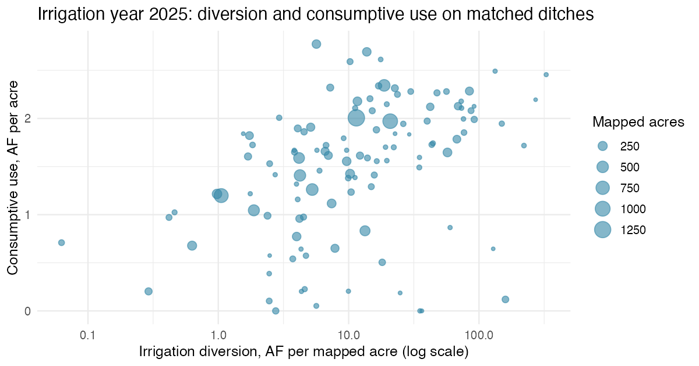
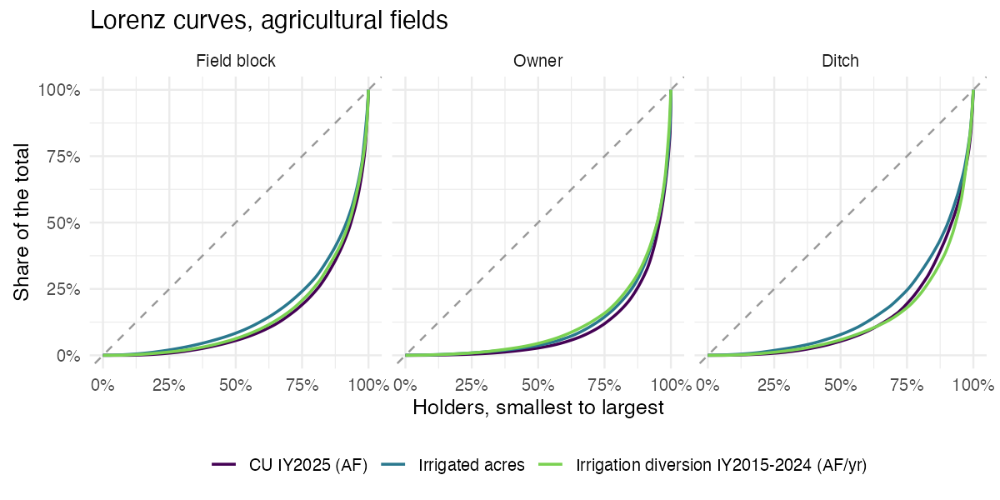

# Diversions, rights, and landowners

*Roaring Fork River basin (HUC8 14010004). Trial analysis, first published October 2026.*

This chapter covers the second half of the Irrigation tab: how much the ditches serving the mapped fields divert, how evenly land and water are shared, and how water rights priority plays out in dry years. Consumptive use itself is in [Irrigation consumptive use](08-irrigation-cu.md).

## Summary

- The 243 structures linked to the 668 mapped fields diverted about 229,000 AF a year of irrigation-class water from 2015 to 2024, and 244,000 AF in irrigation year 2025.
- On ditches with complete records, fields used up about 10% of the irrigation water diverted to them (12% counting ditch losses). The ratio is low because most diverted water returns to the streams, not because irrigation is wasteful.
- Irrigated land is concentrated. About 690 owners hold the agricultural acres with a known owner. The largest 35 hold half of those acres, and the largest 10% hold 66% of the acres and 70% of the water used up.
- Priority binds. In dry years the most junior third of ditches had 31% of their decreed flow cut off on an average day, against 7% for the most senior third. Juniors kept irrigating largely through augmentation plans.

## Fields to ditches

Each mapped field lists up to nine surface water structures (`SW_WDID1` to `SW_WDID9` in the CDSS layer). 597 fields have one ditch, 59 have two, and 12 have three or four. A field served by several ditches has its acres split equally among them, the CDSS rule.

Ditch water is allocated to fields by each field's share of the acres the ditch serves, where served acres are the larger of the mapped acres and the CDSS parcel use acres. Twelve ditches also serve land outside the basin, so fields inside are not credited with that water. Allocation makes diversion per acre equal within a ditch by construction.

## Diversion records

Monthly records come from CDSS `divrecmonth` for every water class, November 2009 to October 2026. Diversions are summarized by irrigation year (November to October).

- **Headgate total**: the sum of the "Total (Diversion)" rows, one per account.
- **Use**: every water class is assigned one use from its use code. Administrative rows, same-structure account transfers, and water another linked ditch diverted and this one only carries are dropped, so nothing is counted twice. Water released back to the stream under an exchange or augmentation account is its own category.
- **Pass-through water**: fishery and recreation classes (mostly the Paterson D Jacob Extension and RFC Ditch) run through ponds and return to the river. They are reported but left out of irrigation totals.
- A ditch with no records is unknown, not zero. 49 of the 243 structures have no records from 2010 on; they serve 2,352 mapped acres.

Use categories add up to the headgate total in essentially every ditch-year. CDSS cannot split the irrigation class between mapped fields and other land under the same ditch (lawns, subdivisions, ponds), or between farms on one ditch.

| Use (water class) | 2015 to 2024 mean (AF/yr) | 2025 (AF) |
|---|---|---|
| Irrigation | 229,100 | 244,000 |
| Fishery (pass-through) | 65,700 | 92,200 |
| Released to stream | 10,700 | 11,600 |
| Quantity only (mixed ditches) | 8,600 | 0 |
| Recreation (pass-through) | 4,200 | 1,800 |
| Carried to another structure | 3,400 | 3,100 |
| Stock, power, domestic, recharge | about 1,300 | about 1,700 |

The Irrigation tab's diversion chart shows irrigation-class water allocated to the mapped fields: 240,000 AF in 2025. Records for 2026 are provisional and still being entered (64 to 89 ditches reporting per month in the summer, against 112 to 149 in 2024 and 2025).

## Consumptive use against diversion

The ratio uses **matched ditches**: ditches with a record that year and at least 5 mapped acres, all of whose fields are served only by ditches that also reported.

| Irrigation year | Ditches | Mapped acres | Irrigation diversion (AF) | CU (AF) | CU / diversion | Net CU / diversion |
|---|---|---|---|---|---|---|
| 2025 | 116 | 12,934 | 213,300 | 20,600 | 9.6% | 11.5% |
| 2026 (partial) | 69 | 7,688 | 141,600 | 15,000 | 10.6% | 12.6% |

This ratio is not irrigation efficiency. Most diverted water seeps or runs back to the river and is diverted again downstream; late-season return flow from flooded meadows supports baseflow. Some returns near Glenwood Springs reach the Colorado River below the basin outlet. The irrigation class also serves land outside the field map, which pushes the ratio down by an unknown amount per ditch. On the eight largest Crystal River ditches, an independent OpenET analysis put crop consumption at under 1% to about 30% of diversion (Sackett & Lassalle, 2024).

## Measuring concentration

"Who uses the water" is measured at several levels, because the answer depends on the unit (Cullis & van Koppen, 2007):

- **Field**: the CDSS polygons.
- **Farm block**: fields closer than 10 m to each other, a proxy for one operation.
- **Owner**: assessor parcels under the fields, grouped by normalized owner name (see Landowners).
- **Ditch**: the structure, where diversions and rights are recorded.

Each level is summarized for acres, CU, irrigation diversion, and decreed flow rate (cfs), using agricultural fields only; turf is reported separately.

**Lorenz curve.** Line the holders up from smallest to largest and plot the running share of holders against the running share of the total. If everyone held the same amount, the curve would follow the diagonal. The further it bows below, the more concentrated the quantity.

**Gini coefficient.** Twice the area between the diagonal and the Lorenz curve. It runs from 0 (everyone holds the same) to near 1 (one holder has everything). For sorted values x₁ ≤ ... ≤ xₙ, G = Σ (2i - n - 1) xᵢ / (n Σ xᵢ).

**Top shares** (the share held by the largest 10% of holders and by the top 10) and **holders with half** (how few holders account for half the total) are easier to read and are reported alongside.

| Level | Quantity | Holders | Gini | Largest 10% hold | Holders with half |
|---|---|---|---|---|---|
| Farm block | Acres | 374 | 0.67 | 54% | 32 |
| Farm block | CU 2025 | 374 | 0.73 | 60% | 25 |
| Owner | Acres | 689 | 0.77 | 66% | 35 |
| Owner | CU 2025 | 689 | 0.80 | 70% | 30 |
| Owner | Irrigation diversion | 583 | 0.76 | 65% | 31 |
| Ditch | Acres | 240 | 0.66 | 51% | 23 |
| Ditch | Irrigation diversion | 181 | 0.73 | 61% | 13 |

CU is a little more concentrated than land at every level (Gini 0.03 to 0.06 higher). For comparison, registered irrigation users in South Africa's Olifants basin had a Gini of 0.81 (Cullis & van Koppen, 2007), and Chile's surface consumptive rights 0.95 (Correa-Parra et al., 2020). Those studies use different units, so the comparison is loose.

**Equity per acre.** A second question is whether each acre gets a similar depth of water. Here the population is acres, not holders (Shah et al., 2016). Irrigation diversion per mapped acre across reporting ditches has an acre-weighted Gini of 0.54 for 2015 to 2024 and 0.60 for 2025, though part of that spread is water going to land outside the map.

**Adequacy.** CU divided by the full-supply crop requirement (NIWR) for each irrigated field, adapted from Molden and Gates (1990). The median is near 1.0. In 2025, 15% of agricultural fields were below 0.75; in 2026, the lowest snowpack since 2010, 22% were. A median above 1 means eeMETRIC often exceeds the crop-coefficient requirement on these meadows, so read adequacy as relative.

## Landowners

CDSS records water rights by structure and lists contacts, not owners or ditch company shareholders. Owners come from county assessor parcels in the Colorado Governor's Office of Information Technology (OIT) statewide parcel layer.

1. Parcels under each field are found by overlay, and each field's quantities are split among its parcels by area.
2. Owner names are classed (individual, private business such as an LLC, trust, or ranch company, public entity, or ditch company), then normalized (case, punctuation, and suffixes such as LLC, TRUST, ET AL removed).
3. Each normalized name is replaced by a keyed hash (HMAC-SHA256). Names are never stored or published; the same key reproduces the same IDs, so the analysis can be rerun or audited.
4. Public entities (towns, counties, state and federal agencies, the school district) and ditch companies keep a public label.

Eagle County submits "EAGLE COUNTY PROPERTY OWNER" for every parcel, so its 2,008 field acres have no owner and are left out of the owner level. Of the remaining agricultural acres, ranches, LLCs, and trusts hold 79%, individuals 18%, and public entities 2%.

Owners are assessor names. One operator can lease land from many owners, and one family can own through several entities that normalization does not merge, so the owner level is an approximation of who benefits.

## Priority and calls

Colorado allocates water by prior appropriation: older (senior) rights are filled first. When a stream runs short, a senior user can place a call, and junior rights upstream must stop diverting unless they replace the water through an augmentation plan.

- **Rights**: CDSS net amount rights at the linked structures. Each ditch's seniority is the cfs-weighted mean of its rights' administration numbers (lower is older). Ditches are split into three groups holding equal shares of the irrigated acres: senior, middle, and junior.
- **Calls**: CDSS call analysis gives, for each absolute right and each day from April to October, the share of the right that was out of priority and the calling structure. 524 of 528 rights returned results.
- **Dry and wet years**: the three lowest (2012, 2013, 2015) and highest (2011, 2019, 2023) April 1 snowpacks since 2010, from the mean of seven Roaring Fork SNOTEL sites with a full record.

| Group | Ditches | Acres | Decreed cfs per 100 acres | Days oldest right cut off, dry / wet | Share of decreed flow cut off, dry / wet | Augmented share of irrigation, dry |
|---|---|---|---|---|---|---|
| Senior | 74 | 6,239 | 6.0 | 11 / 1 | 7% / 1% | 1% |
| Middle | 29 | 6,148 | 9.3 | 17 / 7 | 20% / 5% | 7% |
| Junior | 121 | 6,790 | 19.0 | 31 / 9 | 31% / 8% | 15% |

Within each source stream, seniority ranks call exposure closely (Spearman correlation 0.67 to 0.96 in dry years). Local tributary calls (Four Mile, C and M, Mason, Walthen ditches) are the most frequent; the Colorado main stem call at Cameo reaches the most rights but only juniors. On Cattle and Fourmile Creeks, where no augmentation is recorded, even senior rights are cut off for weeks. Juniors hold about three times the decreed flow per acre of seniors, mostly junior enlargements that are out of priority when water is short. In 2026 junior and middle ditches had more cut-off days than in any year since 2010 (66 and 31 days); for senior ditches 2012 was worse.

## Limitations

- Irrigation-class diversion also serves land outside the 2023 field map, which biases diversion per acre high and CU / diversion low by unknown amounts per ditch.
- Multi-ditch fields (71 fields, 2,736 acres) get an equal share from each ditch.
- Farm blocks are not farms, and owners are assessor names. Within-ditch shares need ditch company share registers, which are not public.
- 2025 diversion records are provisional and 2026 records are partial until early 2027.
- Call analysis covers absolute rights at the linked structures; augmentation plan coverage shows up only through augmented diversion classes.

## References

Correa-Parra, J., Vergara-Perucich, J. F., & Aguirre-Nuñez, C. (2020). Water privatization and inequality: Gini coefficient for water resources in Chile. *Water, 12*(12), Article 3369. https://doi.org/10.3390/w12123369

Cullis, J., & van Koppen, B. (2007). *Applying the Gini coefficient to measure inequality of water use in the Olifants River water management area, South Africa* (IWMI Research Report 113). International Water Management Institute. https://doi.org/10.3910/2009.113

Magnuson, D. O., & Smith, S. W. (2010). The case for ditch-wide water rights analysis in Colorado. In *Meeting irrigation demands in a water-challenged environment* (pp. 145-151). U.S. Committee on Irrigation and Drainage. https://mountainscholar.org/handle/10217/210900

Molden, D. J., & Gates, T. K. (1990). Performance measures for evaluation of irrigation-water-delivery systems. *Journal of Irrigation and Drainage Engineering, 116*(6), 804-823. https://doi.org/10.1061/(ASCE)0733-9437(1990)116:6(804)

Sackett, H., & Lassalle, L. (2024, March 10; updated 2026, January 6). Crystal River mapping project. *Aspen Journalism*. https://aspenjournalism.org/?p=868034

Shah, M. A. A., Anwar, A. A., Bell, A. R., & ul Haq, Z. (2016). Equity in a tertiary canal of the Indus Basin Irrigation System (IBIS). *Agricultural Water Management, 178*, 201-214. https://doi.org/10.1016/j.agwat.2016.09.018
